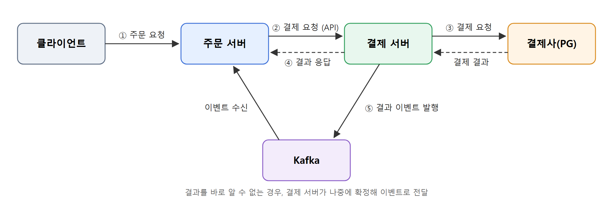

서비스가 여러 개로 늘어나 서로 통신하게 되면, 단일 서비스 환경에서는 보이지 않던 문제들이 생깁니다.  
같은 요청이 중복으로 들어오거나, 메시지가 유실되거나, 여러 서버가 같은 데이터를 동시에 수정하는 일이 발생할 수 있고 이는 데이터 정합성을 깨뜨리는 원인이 됩니다.

이번 게시글에서는 **주문 및 결제 시스템**을 예시로, 분산 환경에서 발생할 수 있는 상황들과 **정합성을 지키기 위해 적용 할 수 있는 방법**에 대해 다뤄보겠습니다.

<br>

## 주문 및 결제 흐름

먼저 예시로 사용할 주문 및 결제 시스템의 흐름은 다음과 같습니다.



1. 클라이언트가 주문을 요청하면 주문 서버가 주문을 저장하고 재고를 차감합니다.
2. 주문 서버가 결제 서버에 **API로 결제를 요청**합니다.
3. 결제 서버는 결제 건을 먼저 저장한 뒤 결제사(PG)에 결제를 요청하고, 결과를 주문 서버에 응답합니다.
4. 주문 서버는 응답받은 결과로 주문 상태를 반영합니다.
5. 결과를 바로 알 수 없던 결제는 결제 서버가 나중에 확정한 뒤 **결과 이벤트를 발행**하고, 주문 서버가 이를 받아 반영합니다.

주문 서버와 결제 서버는 각각 여러 대로 운영되고, Kafka로 이벤트를 전달합니다.
이 흐름에서 발생할 수 있는 상황과 해결 방법을 하나씩 살펴보겠습니다.


<br>

## 1. 같은 주문 요청이 두 번 도착한다

주문 번호는 서버가 생성하기 때문에, 클라이언트가 응답을 받지 못해 다시 보내거나 사용자가 버튼을 두 번 누르면 **주문과 재고 차감이 두 번 발생**하게 됩니다.

서버 입장에서는 두 요청이 같은 요청인지 구분할 방법이 없기 때문에 **멱등성 키(Idempotency Key)**를 사용했습니다.

멱등성 키는 클라이언트가 요청마다 생성하는 고유한 값(예: UUID)으로, `Idempotency-Key` 헤더로 전달됩니다.
재시도할 때는 **같은 키를 그대로 다시 보내기 때문에**, 서버는 키를 보고 이미 처리한 요청인지 판단할 수 있습니다.

서버에서는 멱등성 키를 별도 테이블에 저장하고, **`(endpoint, user_id, idempotency_key)`를 UNIQUE**로 설정했습니다.
엔드포인트와 사용자까지 묶었기 때문에, 서로 다른 API나 다른 사용자가 우연히 같은 키를 보내더라도 충돌하지 않습니다.

```sql
CREATE TABLE idempotency_key (
    id,
    endpoint,
    user_id,
    idempotency_key,
    request_hash,
    response,
    created_at,
    UNIQUE (endpoint, user_id, idempotency_key)
);
```

요청이 들어오면 다음과 같이 처리합니다.

- 처음 보는 키라면 요청 본문의 해시와 함께 키를 저장하고, 주문을 처리한 뒤 **응답을 함께 저장**합니다.
- 이미 저장된 키이고 요청 본문도 같다면, 주문을 다시 처리하지 않고 **저장된 응답을 그대로 반환**합니다.
- 키는 같은데 **요청 본문이 다르다면** 클라이언트가 키를 잘못 재사용한 것이므로 **409**로 응답합니다.

두 요청이 동시에 들어와 둘 다 조회를 통과하더라도, **UNIQUE 제약 조건**에 걸려 나중에 들어온 요청은 실패하기 때문에 같은 주문이 중복 생성되지 않습니다.

저장된 키와 응답은 영구적으로 보관할 필요가 없기 때문에, **일정 시간이 지나면 삭제**하도록 정책을 추가 할 수 있습니다.

<br>

## 2. 주문은 저장됐는데 이벤트 발행 전에 서버가 죽는다

DB 저장과 메시지 발행은 서로 다른 시스템이라 하나의 트랜잭션으로 묶을 수 없습니다.
DB 커밋 후 이벤트 발행 전에 서버가 죽으면 **DB에는 반영됐지만 이벤트는 유실**됩니다.

이를 해결하기 위해 **Transactional Outbox 패턴**을 적용했습니다.
이벤트를 바로 발행하지 않고 비즈니스 데이터와 **같은 트랜잭션에서 Outbox 테이블에 저장**하기 때문에, 서버가 죽더라도 저장된 이벤트를 발행할 수 있습니다.

또한 이벤트가 Outbox 테이블에 **기록으로 남기 때문에** 발행 이력을 추적할 수 있어, **디버깅이 쉽고 필요한 이벤트를 재발행**할 수도 있습니다.

> Outbox 패턴에 대한 자세한 내용은 이전 게시글에서 확인할 수 있습니다.
> - [Transaction Outbox Pattern과 폴링 방식 구현]()
> - [Transactional Outbox Pattern - Transaction Log Tailing 구현]()

<br>

## 3. 두 주문이 같은 상품 재고를 동시에 줄인다

재고 10개인 상품에 두 주문이 동시에 들어오면 다음과 같은 문제가 생깁니다.

- 주문 A가 재고 10개를 읽습니다.
- 주문 B도 재고 10개를 읽습니다.
- 주문 A가 1개를 차감해 9개로 저장합니다.
- 주문 B도 1개를 차감해 9개로 저장합니다.
- 2개가 주문됐지만 **재고는 8개가 아니라 9개**로 남습니다.

재고는 정확성이 중요하고 충돌이 자주 일어나는 데이터이기 때문에 **비관적 락**을 선택했습니다.  
비관적 락은 충돌 방지와 더불어, 엔티티를 잠근 상태로 읽어오기 때문에 재고 확인과 차감을 **도메인 로직으로 표현**할 수 있다는 장점이 있습니다.

```java
public class Product {

    public void decrease(int quantity) {
        if (this.stock < quantity) {
            throw new BusinessException(ErrorCode.OUT_OF_STOCK);
        }
        this.stock -= quantity;
    }
}
```

```java
Product product = productRepository.lock(productId);
product.decrease(quantity);
```

상품을 잠가 읽은 뒤 `decrease()`가 품절 여부를 판단하고 재고를 차감합니다.

<br>

락 없이 **조건부 업데이트**로 재고를 차감하는 방법도 있습니다.

```sql
UPDATE product
SET stock = stock - :quantity
WHERE id = :productId
  AND stock >= :quantity
```

한 번의 쿼리로 확인과 차감이 원자적으로 처리되지만, 품절 판단이 `WHERE stock >= :quantity` 조건으로 쿼리에 들어가기 때문에 **위의 `decrease()` 메소드가 쓸모 없어지게 됩니다.**
즉 비즈니스 판단이 도메인이 아니라 **쿼리에 들어가게 됩니다.**

비관적 락을 사용하면 이런 규칙이 쿼리에 흩어지지 않고 도메인 안에 모이기 때문에 규칙을 파악하고 테스트하기가 쉬워집니다.

<br>

### 비관적 락 적용 시 주의할 점

#### 1차 캐시

`find(Product.class, id, PESSIMISTIC_WRITE)`로 잠금을 걸게되면, **1차 캐시** 때문에 다음과 같은 문제가 발생 할 수 있습니다.

- 트랜잭션 A가 잠금 없이 상품을 조회합니다. (재고 10개, 1차 캐시에 저장)
- 그 사이 트랜잭션 B가 재고를 1개 차감하고 커밋합니다. (DB 재고 9개)
- 트랜잭션 A가 재고 차감을 위해 `find(..., PESSIMISTIC_WRITE)`로 상품을 잠급니다.
- 잠금은 걸리지만 상품이 이미 1차 캐시에 있어 **캐시된 객체(재고 10개)를 그대로 반환**합니다.
- 트랜잭션 A가 10개에서 1개를 차감해 9개로 저장합니다.
- 2개가 차감됐지만 **재고는 8개가 아니라 9개**로 남습니다.

즉 잠금을 잡고도 최신 재고를 읽지 못해, 비관적 락을 적용하기 전과 같은 문제가 다시 발생하게 됩니다.

<br>

```java
public Product lock(Product product) {
    entityManager.refresh(product, LockModeType.PESSIMISTIC_WRITE);
    return product;
}
```
`refresh`는 1차 캐시에 있던 객체도 잠그면서 DB의 최신 값으로 다시 읽어오기 때문에 이 문제를 피할 수 있습니다.

<br>

#### 잠금 순서

**데드락**은 두 트랜잭션이 서로가 가진 잠금을 기다리면서, 어느 쪽도 진행하지 못하고 멈추는 상황을 말합니다.

여러 상품을 잠글 때 순서가 정해져 있지 않으면 다음과 같이 데드락이 발생할 수 있습니다.

- 트랜잭션 A가 상품 1을 잠급니다.
- 트랜잭션 B가 상품 2를 잠급니다.
- 트랜잭션 A가 상품 2를 잠그려 하지만, B가 쥐고 있어 기다립니다.
- 트랜잭션 B가 상품 1을 잠그려 하지만, A가 쥐고 있어 기다립니다.
- 두 트랜잭션이 서로를 기다리며 **데드락**에 빠집니다.

이를 막기 위해 잠금 순서를 **`id` 오름차순**으로 고정했습니다.


<br>


## 4. 결제는 요청했는데 결과를 알 수 없다

결제사 호출이 타임아웃, 연결 끊김, 5xx로 끝나면 **실제로 결제가 됐는지 알 수 없습니다.**

이 상황을 실패로 처리하면, 실제로는 돈이 빠져나갔는데 주문은 실패로 확정되고 재고까지 복원되는 문제가 생깁니다.

그래서 결제사로부터 **명확한 성공·실패 응답을 받은 경우에만 결제 결과를 확정**하도록 했습니다.

- 200 → `결제 성공`
- 4xx (명시적 거절) → `결제 실패`
- 그 외 (타임아웃, 연결 실패, 5xx, 응답 파싱 실패 등) → `결제 진행중` 유지

명확한 성공·거절이 아니면 모두 `결제 진행중`으로 남기기 때문에, **실제로 결제됐는데 주문이 실패로 처리되는 일**은 생기지 않습니다.

<br>

`결제 진행중`으로 남은 결제는 **스케줄러가 주기적으로 결제사에 결제 상태를 조회**해 확정합니다.

- 스케줄러는 일정 주기마다 확인 시점이 된 `결제 진행중` 결제를 가져와, 결제사에 상태 조회를 요청합니다.
- 결제사가 결제 완료나 실패로 명확히 답한 경우에만 확정하고, 그 외는 다음 주기에 다시 확인합니다.
- 확인을 무한정 반복할 수는 없기 때문에 횟수에 상한을 두고, 상한을 넘으면 **`결제 확인 불가`로 전환해 추후 별도로 확정**합니다.


<br>

## 5. 같은 이벤트가 두 번 도착한다

Kafka는 메시지를 **최소 한 번(at-least-once)** 전달하기 때문에, 재시도나 리밸런스 과정에서 같은 메시지가 컨슈머에 여러 번 전달될 수 있습니다.
앞서 적용한 Outbox 패턴 역시 발행 후 완료 표시 전에 서버가 죽으면 같은 이벤트를 다시 발행하게 됩니다.

즉 **중복 메시지 자체는 막을 수 없기 때문에, 컨슈머가 같은 메시지를 여러 번 받더라도 결과가 한 번만 반영되도록** 처리해야 합니다.

<br>

### 이벤트 ID 기반 처리

이벤트마다 고유한 이벤트 ID를 부여하고, 컨슈머가 처리한 이벤트 ID를 테이블에 기록해 중복을 걸러내는 방법입니다.

- 이벤트를 받으면 먼저 이벤트 ID로 처리 이력을 조회합니다.
- 처리한 적이 없으면 비즈니스 로직을 수행하고, 같은 트랜잭션에서 이벤트 ID를 저장합니다.
- 같은 이벤트가 다시 오면 이미 기록된 이벤트 ID라 그대로 넘어갑니다.

어떤 이벤트에도 적용할 수 있지만, 처리 이력을 저장할 **별도의 테이블이 필요**합니다.

<br>

### 상태 기반 처리

데이터의 현재 상태를 보고, 이미 반영된 결과라면 넘어가는 방법입니다.

주문·결제는 **상태가 명확하게 정해져 있기 때문에**, 별도의 기록 없이 상태 기반으로 처리 할 수 있습니다.
주문 상태는 다음과 같은 흐름으로만 변경됩니다.

- 결제 대기 → 결제 진행 중 -> 결제 성공 또는 결제 실패

이벤트를 받으면 현재 상태에서 **바뀔 수 있는 경우에만 반영**하고, 바뀔 수 없다면 이미 처리된 이벤트로 보고 넘어갑니다.  
예를 들어 결제 실패 이벤트가 두 번 오면, 두 번째는 이미 결제 실패 상태라 무시됩니다.


