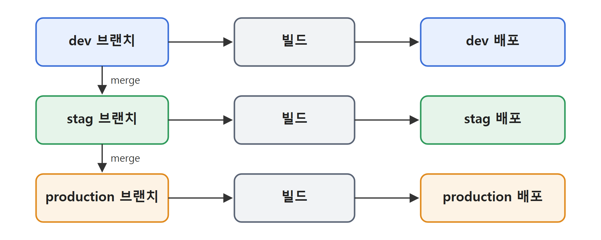
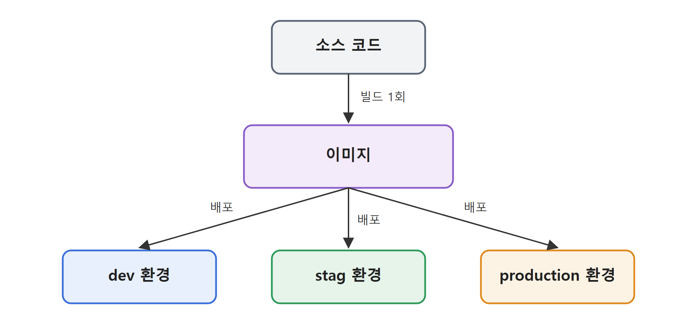
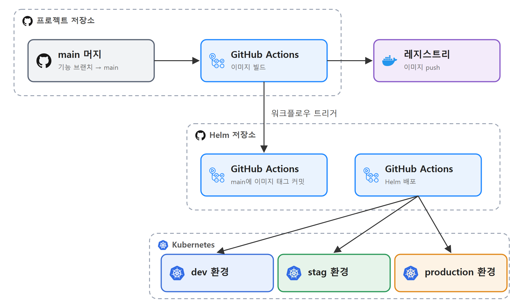

테스트와 운영을 위해 여러 배포 환경을 두고 있었고, 이 환경마다 브랜치를 두고 해당 브랜치에 머지하면 **이미지를 새로 빌드**해 배포했었습니다.  
단순하고 직관적인 방식이었지만, 배포할 때마다 머지와 빌드를 반복해야 하는 불편함이 있었습니다.

이번 게시글에서는 기존 배포 방식에서 겪었던 문제를 살펴보고, 이를 어떻게 개선했는지 다뤄보겠습니다.

<br>

## 기존 방식: 환경별 브랜치에서 각각 빌드

배포 환경으로는 **dev, stag, production**이 있었고, 각 환경에 배포하기 위해 프로젝트 저장소마다 `dev`, `stag`, `production` 브랜치를 뒀습니다.

배포 흐름은 다음과 같습니다.



1. 개발한 내용을 `dev` 브랜치에 머지하면, `dev` 브랜치 코드로 이미지를 빌드해 dev 환경에 배포합니다.
2. dev 검증이 끝나면 `dev` → `stag`로 머지하고, `stag` 브랜치 코드로 **다시 빌드**해 stag 환경에 배포합니다.
3. stag 검증이 끝나면 `stag` → `production`으로 머지하고, `production` 브랜치 코드로 **다시 빌드**해 production 환경에 배포합니다.

<br>

이 방식은 직관적이지만, 다음과 같은 문제가 있었습니다.

- **배포할 때마다 브랜치를 계속 머지해야 합니다.**  
기능 하나를 production까지 올리려면 `dev` → `stag` → `production`으로 매번 머지해야 합니다.
- **빌드 시간이 환경 수만큼 추가됩니다.**  
같은 코드를 dev, stag, production에서 세 번 빌드합니다.
- **검증한 이미지와 배포한 이미지가 다를 수 있습니다.**  
stag에서 테스트한 것은 stag 브랜치로 만든 이미지이고, production에는 production 브랜치로 **다시 만든 이미지**가 사용됩니다. 같은 코드를 사용했더라도 빌드 시점의 의존성이나 베이스 이미지가 바뀌면 결과물이 달라질 수 있습니다.

위와 같은 불편함이 있었고 이러한 문제를 해결하기 위해 **Build Once, Deploy Many** 방식을 적용했습니다.

<br>

## Build Once, Deploy Many란

Build Once, Deploy Many는 말 그대로 **한 번만 빌드하고, 그 결과물을 여러 환경에 배포**하는 방식입니다.



- 소스 코드는 **한 번만 빌드**해 컨테이너 이미지를 만듭니다.
- dev, stag, production 모두 동일한 이미지를 사용하며, 환경별로 달라지는 부분은 환경별 설정을 주입해 처리합니다.

<br>

기존 방식과 비교했을 때, 이 방식이 가진 장점은 다음과 같습니다.

- **검증한 이미지가 그대로 배포됩니다.**  
dev,stag에서 테스트한 이미지를 production에서도 사용하므로, 빌드 시점에 따라 결과물이 달라질 일이 없습니다.
- **한 번만 빌드하면 됩니다.**  
환경이 바뀔 때마다 다시 빌드하지 않고, 이미 만든 이미지를 배포하기만 하면 됩니다.
- **환경별 브랜치를 둘 필요가 없습니다.**   
배포할 때마다 `dev` → `stag` → `production` 브랜치로 머지하지 않아도 됩니다.

<br>

## 개선 방식 적용

현재 프로젝트는 저장소로 **GitHub**, 빌드 도구로 **GitHub Actions**, 배포에는 **Helm**을 사용하고 있어,   
이를 활용해 Build Once, Deploy Many 방식을 적용해 보았습니다.


전체 흐름은 아래와 같으며, 각 단계를 하나씩 살펴보겠습니다.




<br>

### 1. main 브랜치로 통합

환경별로 따로 빌드할 필요가 없기 때문에, 브랜치를 **main 하나로 통합**했습니다.

기능 개발은 `feature/*`와 같은 별도 브랜치에서 진행하고, main에 머지합니다.
main에 머지되면 이를 트리거로 **GitHub Actions** 워크플로우가 실행되어, 이미지를 빌드하고 레지스트리에 push합니다.

<br>

### 2. Helm 저장소에 이미지 태그 반영

Helm 차트와 환경별 설정은 별도의 Helm 저장소로 관리하고 있어, main 머지로 실행된 워크플로우가 **Helm 저장소의   
워크플로우를 트리거**하도록 했습니다.  
트리거된 워크플로우는 전달받은 **이미지 태그를 Helm 저장소 main 브랜치에 커밋**합니다.

<br>

<!--
### 3. 릴리즈 확정: 검증된 커밋에 태그를 단다

dev에서 검증이 끝나면, 그 시점의 Helm 저장소 커밋에 **git 태그**를 붙입니다.

```bash
git tag v1.3.0 <검증된 커밋>
git push origin v1.3.0
```

이 커밋에는 검증에 사용한 이미지 태그가 기록되어 있으므로, **`v1.3.0` 태그 = 이번 릴리즈에 배포될 이미지**가 됩니다.

태그를 붙인 이후에도 main에서는 다음 버전 개발이 계속 진행되지만, 태그는 움직이지 않기 때문에 릴리즈 대상이 바뀌지 않습니다.

<br>

> 릴리즈 버전마다 `release/1.3.0` 같은 브랜치를 미리 만들어 두는 방법도 있습니다.
> 하지만 이 경우 버전이 정해질 때마다 **여러 저장소에 브랜치를 미리 만들어야** 하고, 릴리즈가 잦을수록 **브랜치가 계속 쌓여** 어떤 브랜치를 지워도 되는지 판단하기 어려워집니다.
> 태그는 **릴리즈할 시점에 "이 상태가 v1.3.0이다"라고 이름만 붙이는 것**이기 때문에 이런 관리 부담이 없습니다.

<br>
-->

### 3. 같은 이미지 태그로 각 환경에 배포

배포는 Helm 저장소의 워크플로우에서 **배포할 환경을 입력**받아 실행합니다.  
워크플로우는 Helm 저장소에 커밋된 이미지 태그와 해당 환경의 설정을 함께 적용해 배포합니다.

기존 방식에서는 브랜치를 머지하고 다시 빌드해야 했다면, 이제는 **환경만 바꿔서 같은 이미지를 배포**하면 됩니다.

<br>

<!--
## 핫픽스는 필요할 때만 브랜치를 만든다

main에서 개발하면 가장 먼저 드는 걱정은 **"production에 나간 v1.3.0에 버그가 있는데, main에는 이미 다음 버전 코드가 들어가 있으면 어떻게 하지?"** 입니다.

이때만 **릴리즈 태그에서 브랜치를 만들면 됩니다.**

1. production 이미지의 커밋(이미지 태그의 커밋 해시)으로부터 `hotfix/1.3.1` 브랜치를 만들고 수정합니다.
2. 수정한 코드로 **한 번 빌드**해 새 이미지를 만듭니다.
3. 새 이미지를 stag에 배포해 검증합니다.
4. 검증이 끝나면 해당 커밋에 `v1.3.1` 태그를 붙이고 production에 배포합니다.
5. 수정 내용은 main에도 반영(cherry-pick)합니다.

<br>

```
main ──●──●──●──●──●──●──▶ (다음 버전 개발 계속)
          │
       v1.3.0 (tag)
          │
          └──● hotfix/1.3.1
             │
          v1.3.1 (tag)
```

대부분의 릴리즈는 태그 하나로 끝나기 때문에 브랜치가 쌓이지 않고, 핫픽스 브랜치도 릴리즈가 끝나면 지워도 됩니다.

<br>

-->

## 주의사항

### production 배포에는 안전장치 필요

기존에는 `production` 브랜치에 머지하는 과정이 일종의 확인 절차 역할을 했습니다.  
하지만 배포할 환경을 입력으로 고르기 때문에, 테스트가 끝나지 않은 상태에서 의도치 않게 production에 배포되면 장애로 이어질 수 있습니다.  
그래서 production 배포 워크플로우는 **승인자의 승인이 있어야 진행**되도록 했습니다.

